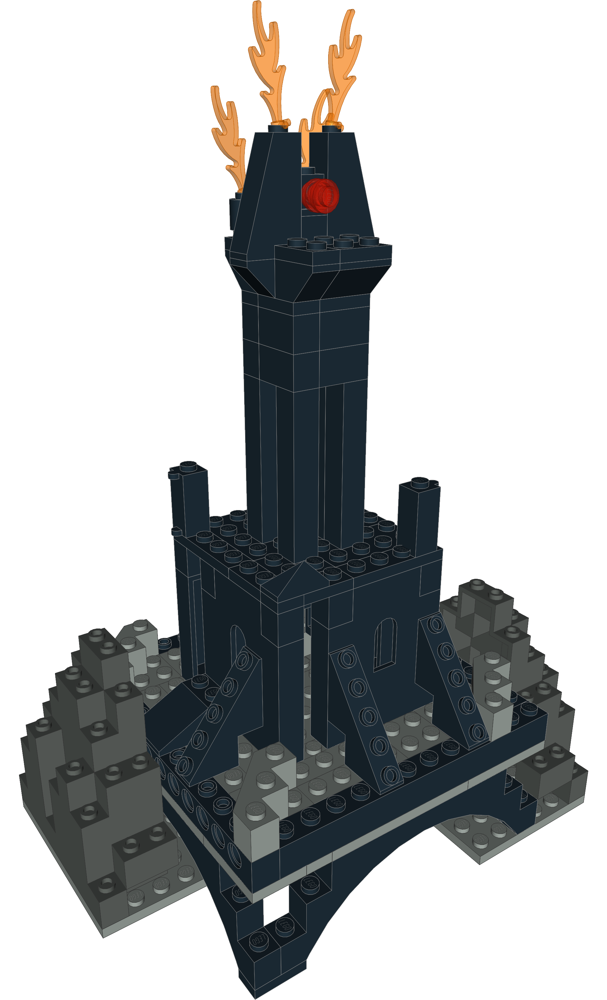

# Barad-dûr from the parts of LEGO 6082-1 "Fire Breathing Fortress"

A concept MOC of Sauron's Dark Tower that uses **only** parts contained in LEGO set 6082-1 (1993),
never more of a part than the set contains. 135 parts, 13 building steps, about 23 cm tall.



## Files

| File                         | What it is                                                                                                                                        |
|------------------------------|---------------------------------------------------------------------------------------------------------------------------------------------------|
| `barad_dur.ldr`              | LDraw model with 13 `STEP`s. Opens in LDView, LeoCAD, Studio 2.0, MLCad etc.                                                                      |
| `barad_dur.png`              | Render of the model (LDView, front-right view).                                                                                                   |
| `barad_dur_instructions.pdf` | 18-page building instructions: cover, concept, parts list, one page per step with the parts of that step and a call-out of the newly added parts. |
| `renders/`                   | Additional views (back, left side, dark-background cover render).                                                                                 |
| `src/`                       | The scripts that generate everything (see below).                                                                                                 |

## The concept

The silhouette follows the classic reading of the tower: a wide, hollow arched foundation growing out of rock,
a massive walled body with buttresses, a slender shaft, and a flaring crown whose two horns frame the Eye.
Everything is arranged as pinwheels (arches, parapet, wall panels, shaft rings), which gives the tower the
twisted, asymmetric look of the film design.

- **Foundations.** Four 1x12x3 arches (three black, one light gray at the back) form a 13x13 ring with an open arch on every side. A central 2x2 pillar of light gray bricks supports the plate deck. Two dark gray rock panels (3x8x7) flank the base as the crag.
- **Platform.** A black ring of long bricks (1x12, two Technic 1x12 with holes, 1x8+1x4) forms the parapet; light gray bricks fill the ring to a flat platform.
- **Body.** The four black 2x5x6 wall panels with windows stand in a pinwheel around a 3x3 hollow, six bricks high. The three 3x1x3.3 slopes with studs on the slope lean against the walls as iron buttresses, smaller slopes and the four 3x3 facet bricks complete the platform. The jagged panel tops are levelled with 1x1 bricks and 1x2 plates and capped in black; two 2x1 triple slopes and two 1x1x2 bricks form corner pinnacles.
- **Shaft.** Four 1x1x5 bricks and a 1x2x5 brick form a hollow 3x3 shaft with two open slits, closed by two pinwheel rings of 1x2 bricks and a plate cap.
- **Crown and Eye.** Inverted 45° slopes flare the crown outwards. Two 75° 1x2x3 slopes are the horns; a headlight brick between them carries two trans-red 1x1 round plates as the Eye. The set's four trans-neon-orange flames plug with their bar ends into the horns' open studs and into two 1x1 round bricks behind the Eye.

Not used: the dragon, horse, minifigures, weapons, plants, red roof, brown doors and arches, treasure chest,
turret parts and the raised baseplate. Everything in the model is black, light gray, dark gray, trans-red or
trans-neon-orange.

## Notes and caveats

- The inventory was taken from BrickLink's inventory of 6082-1 (regular parts plus the counted extra parts, minifigures excluded) and cross-checked against BrickOwl. It is encoded in `src/inventory.py`; the builder refuses to place a part that would exceed the set's quantity.
- One of the four black wall panels in the set is the printed one (two yellow dragons). It is placed at the back. The LDraw library has no file for that exact print, so the `.ldr` uses the plain `4444.dat` for all four.
- Parts are placed on the stud grid with the standard LDraw part origins, so all connections are legal stud/tube or bar-in-hollow-stud connections. Two things are worth checking with real bricks: the deck plates rest only on the middle eight studs of each arch (the arch ends step down), and the flames' bar ends sit in hollow studs, which is a loose fit on old 1x1 round bricks.
- This is a fan concept. LEGO® is a trademark of the LEGO Group, which does not sponsor or endorse it.

## Regenerating

Requirements: Python 3 with `numpy`, `Pillow`, `reportlab`; the LDraw parts library (`complete.zip` from
ldraw.org) extracted to `ldraw/` next to the scripts; LDView portable (`LDView64.exe`) in `ldview/`.

```bash
python barad_dur.py barad_dur.ldr                 # build the model, check inventory, write the LDR with STEPs
./render.sh barad_dur.ldr barad_dur.png 2400 3200 22 -35
./ldview/LDView64.exe barad_dur.ldr -LDrawDir=.../ldraw -SaveSnapshot=.../steps/step.png -SaveSteps=1 -SaveStepsSameScale=1 ...
python make_thumbs.py barad_dur.ldr               # part thumbnails for the parts lists
python make_pdf.py barad_dur.ldr barad_dur_instructions.pdf
```

`src/builder.py` is a small placement helper: `place(part, colour, x, z, level, rot)` aligns a part's footprint to a
stud position and its bottom to a plate level, tracks the inventory and warns about overlapping footprints.
`src/ldparse.py` reads LDraw part geometry (used to measure part footprints and orientations).

## Parts used

| used | in set | part  | colour            | name                                               |
|------|--------|-------|-------------------|----------------------------------------------------|
| 3    | 3      | 6108  | Black             | Arch 1x12x3                                        |
| 10   | 21     | 3005  | Black             | Brick 1x1                                          |
| 1    | 2      | 4070  | Black             | Brick 1x1 Headlight                                |
| 2    | 2      | 3062b | Black             | Brick 1x1 Round                                    |
| 1    | 1      | 6112  | Black             | Brick 1x12                                         |
| 2    | 2      | 3581  | Black             | Brick 1x1x2 Shutter Holder                         |
| 4    | 4      | 2453a | Black             | Brick 1x1x5                                        |
| 8    | 15     | 3004  | Black             | Brick 1x2                                          |
| 1    | 1      | 2454  | Black             | Brick 1x2x5                                        |
| 1    | 1      | 3010  | Black             | Brick 1x4                                          |
| 1    | 2      | 3008  | Black             | Brick 1x8                                          |
| 4    | 4      | 4444  | Black             | Panel 2x5x6 Wall with Window (3 plain + 1 printed) |
| 1    | 1      | 3024  | Black             | Plate 1x1                                          |
| 15   | 16     | 3023  | Black             | Plate 1x2                                          |
| 2    | 5      | 3710  | Black             | Plate 1x4                                          |
| 2    | 2      | 3022  | Black             | Plate 2x2                                          |
| 1    | 4      | 2420  | Black             | Plate 2x2 Corner                                   |
| 2    | 2      | 3020  | Black             | Plate 2x4                                          |
| 1    | 2      | 3031  | Black             | Plate 4x4                                          |
| 2    | 2      | 4286  | Black             | Slope 33 3x1                                       |
| 1    | 1      | 3298  | Black             | Slope 33 3x2                                       |
| 2    | 2      | 3040b | Black             | Slope 45 2x1                                       |
| 2    | 2      | 3048b | Black             | Slope 45 2x1 Triple                                |
| 1    | 1      | 3037  | Black             | Slope 45 2x4                                       |
| 3    | 3      | 6044  | Black             | Slope 53 3x1x3.3 Studs on Slope                    |
| 2    | 2      | 4460a | Black             | Slope 75 2x1x3                                     |
| 4    | 5      | 3665a | Black             | Slope Inv 45 2x1                                   |
| 2    | 2      | 3660a | Black             | Slope Inv 45 2x2                                   |
| 2    | 2      | 3895  | Black             | Technic Brick 1x12                                 |
| 1    | 1      | 6108  | Light Gray        | Arch 1x12x3                                        |
| 8    | 25     | 3004  | Light Gray        | Brick 1x2                                          |
| 4    | 8      | 3622  | Light Gray        | Brick 1x3                                          |
| 6    | 6      | 3010  | Light Gray        | Brick 1x4                                          |
| 3    | 3      | 3003  | Light Gray        | Brick 2x2                                          |
| 2    | 2      | 3002  | Light Gray        | Brick 2x3                                          |
| 1    | 1      | 3001  | Light Gray        | Brick 2x4                                          |
| 4    | 4      | 2462  | Light Gray        | Brick 3x3 Facet                                    |
| 1    | 4      | 3623  | Light Gray        | Plate 1x3                                          |
| 1    | 2      | 3710  | Light Gray        | Plate 1x4                                          |
| 2    | 2      | 3666  | Light Gray        | Plate 1x6                                          |
| 1    | 1      | 3022  | Light Gray        | Plate 2x2                                          |
| 1    | 1      | 3021  | Light Gray        | Plate 2x3                                          |
| 1    | 2      | 3020  | Light Gray        | Plate 2x4                                          |
| 1    | 3      | 3795  | Light Gray        | Plate 2x6                                          |
| 1    | 1      | 3029  | Light Gray        | Plate 4x12                                         |
| 3    | 3      | 3031  | Light Gray        | Plate 4x4                                          |
| 1    | 1      | 3032  | Light Gray        | Plate 4x6                                          |
| 2    | 2      | 3036  | Light Gray        | Plate 6x8                                          |
| 2    | 2      | 6083  | Dark Gray         | Rock Panel 3x8x7                                   |
| 2    | 3      | 6141  | Trans-Red         | Plate 1x1 Round                                    |
| 4    | 4      | 6126a | Trans-Neon Orange | Flame with Pegs                                    |
